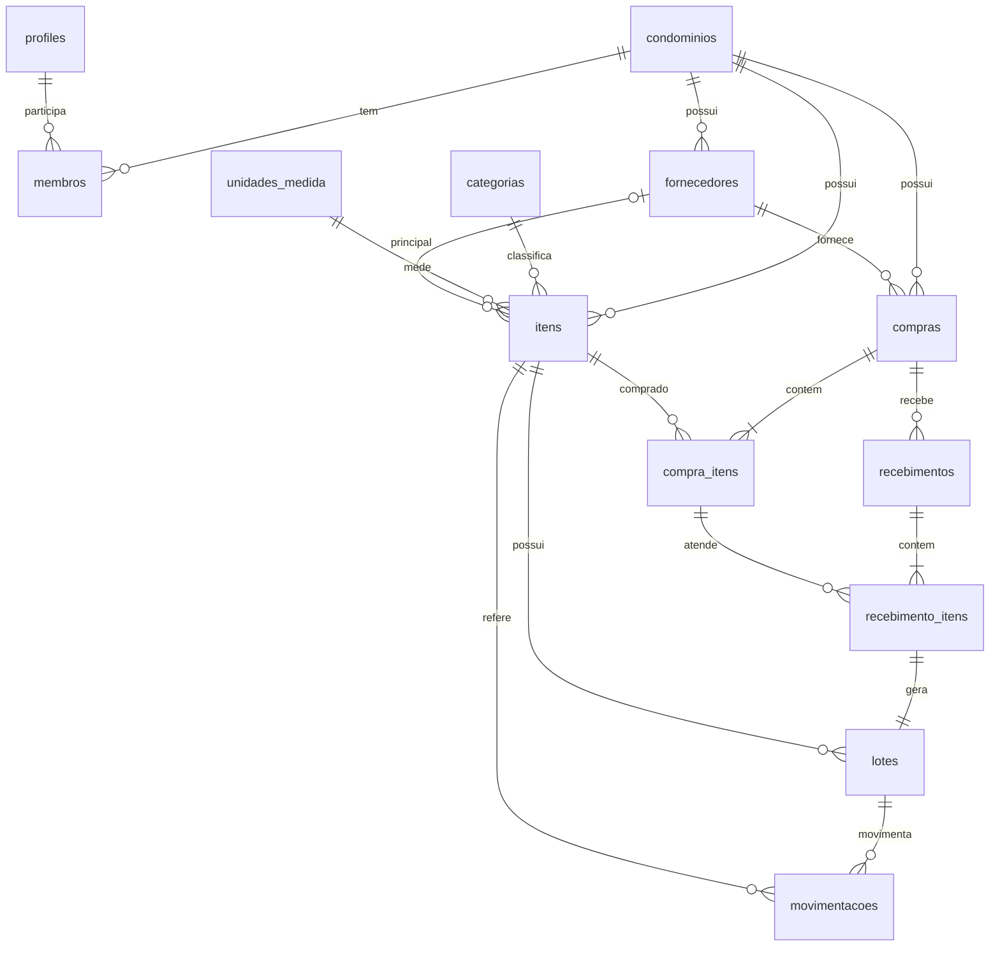

# Fase 2 — Planejamento técnico

Plataforma de gestão condominial: evolução do app de estoque existente.
Este documento **não altera nada**: é o plano para aprovação antes da Fase 3.

## 0. Decisões já tomadas

| Tema | Decisão |
|---|---|
| Papéis | `superadmin`, `sindico`, `gestor` (comissão), `morador`. Não há papel de zelador. |
| Aprovação de compras | Só o síndico (ou superadmin) aprova. Gestor não aprova as próprias compras. |
| Ajuste de estoque | Não exige aprovação. Exige justificativa e fica registrado. |
| Multi-condomínio | Todas as tabelas com `condominio_id`, isolamento por RLS. Superadmin é global. |
| Morador | Sem acesso a estoque, compras, fornecedores ou perfis de outras pessoas. |
| Código | Estático, sem build, separado em módulos ES (compatível com GitHub Pages). |
| Nota fiscal | Anexo no Supabase Storage (bucket privado). |
| Gráficos | Chart.js com versão fixa, gratuito. |
| Dados atuais | Só testes (1 item, 3 movimentações). Não serão migrados. |

## 1. Princípios de arquitetura

1. **O estoque é resultado, nunca um campo editável.** O saldo de cada lote é a fonte de verdade. O estoque do item é a soma dos saldos dos seus lotes, calculada em uma view.
2. **Toda mudança de estoque passa por uma função no banco (RPC)**, que roda numa única transação. O navegador não tem permissão de `insert`, `update` ou `delete` direto em lotes, movimentações, recebimentos ou auditoria.
3. **Movimentações são um livro-razão imutável.** Não há `update` nem `delete`. Erros são corrigidos com estorno (nova movimentação que referencia a original).
4. **O banco valida tudo**: permissões, saldo suficiente, condomínio correto, quantidades positivas. A validação visual é só conveniência.
5. **Isolamento entre condomínios é garantido pelo banco**, inclusive com chaves estrangeiras compostas (`item_id + condominio_id`), para que um registro nunca aponte para item de outro condomínio.
6. **Nada de texto digitado vai para a tela sem escape** (corrige a falha XSS da Fase 1).

## 2. Estratégia de migrations e convivência com o app atual

O app atual usa as tabelas `items`, `movements`, `settings` (nomes em inglês). As novas tabelas usam nomes em português (`itens`, `lotes`, `movimentacoes`…). Por isso **os dois conjuntos convivem** no mesmo projeto, e o site atual continua funcionando até a virada.

Migrations versionadas em `supabase/migrations/`, aplicadas em ordem no SQL Editor (ou pela CLI do Supabase no futuro):

| Arquivo | Conteúdo | Destrutiva? |
|---|---|---|
| `0001_base` | Extensões, funções auxiliares, `search_path` seguro | Não |
| `0002_tenancy` | `condominios`, `membros`, `convites`; `profiles.superadmin`; cria o condomínio inicial e copia os papéis atuais para `membros` | Não (mantém `profiles.papel`) |
| `0003_catalogos` | `categorias`, `unidades_medida` com dados iniciais | Não |
| `0004_fornecedores` | `fornecedores`, `fornecedor_categorias` | Não |
| `0005_itens` | `itens` (sem campo de estoque) | Não |
| `0006_compras` | `compras`, `compra_itens` | Não |
| `0007_estoque` | `lotes`, `recebimentos`, `recebimento_itens`, `movimentacoes` + travas de imutabilidade | Não |
| `0008_funcoes` | Funções RPC (seção 5) | Não |
| `0009_views` | Views de estoque, vencimentos, consumo, gastos, cobertura | Não |
| `0010_rls` | Políticas de acesso e revogação de escrita direta | Não |
| `0011_auditoria` | `auditoria` + gatilhos | Não |
| `0012_storage` | Bucket `notas-fiscais` e políticas | Não |
| `0099_remover_legado` | Remove `items`, `movements`, `settings`, `profiles.papel` e as funções antigas | **Sim. Só após o novo site estar no ar e com a sua aprovação expressa** |

Cada arquivo é pequeno, comentado e pode ser reaplicado com segurança onde possível (`if not exists`, `create or replace`). Testes SQL ficam em `supabase/tests/`.

## 3. Modelo de dados



### 3.1 Tabelas

**Acesso e condomínios**
- `condominios` (id, nome, cnpj, ativo, criado_em)
- `profiles` (id → auth.users, nome, **superadmin** boolean)
- `membros` (condominio_id, user_id, **papel** ∈ sindico | gestor | morador, ativo) — chave primária composta
- `convites` (id, condominio_id, email, papel, criado_por, usado_em) — ao criar conta, o gatilho consome o convite e cria o vínculo. Sem convite, a pessoa entra sem acesso a nada.
- `condominio_config` (condominio_id, faixa_atencao padrão 25%, dias_vencimento_alerta 30 e 90)

**Catálogos** (geridos pelo superadmin, globais)
- `categorias` (id, nome, ativo), `unidades_medida` (id, sigla, nome, ativo)

**Cadastros**
- `fornecedores` (id, condominio_id, nome, razao_social, cnpj, contato, telefone, email, endereco, observacoes, ativo) + `fornecedor_categorias`
- `itens` (id, condominio_id, nome, categoria_id, descricao, unidade_id, **estoque_minimo**, **estoque_ideal**, localizacao, fornecedor_principal_id, ativo, criado_por, criado_em) — check: ideal ≥ mínimo; nome único por condomínio; **sem coluna de estoque atual**

**Compras**
- `compras` (id, condominio_id, data_compra, fornecedor_id, numero_nf, nf_arquivo_path, categoria_id, responsavel_id, observacoes, **status**, aprovada_por, aprovada_em)
  - status: planejada → aguardando_aprovacao → aprovada → pedido_realizado → parcialmente_recebido → recebido; cancelado a partir de qualquer estado antes de "recebido"
- `compra_itens` (id, compra_id, item_id, qtd_solicitada, qtd_recebida, custo_unitario, vencimento_previsto) — custo total = quantidade × custo unitário; valor total da compra é a soma

**Estoque**
- `recebimentos` (id, compra_id, data, responsavel_id, observacao, chave_idempotencia)
- `recebimento_itens` (id, recebimento_id, compra_item_id, quantidade, vencimento, custo_unitario)
- `lotes` (id, condominio_id, item_id, recebimento_item_id, codigo, data_entrada, qtd_recebida, **saldo**, custo_unitario, vencimento, origem ∈ compra | entrada_extraordinaria | doacao | ajuste, responsavel_id) — checks: 0 ≤ saldo ≤ qtd_recebida
- `movimentacoes` (id, condominio_id, item_id, lote_id, **tipo** ∈ entrada | consumo | perda | ajuste | doacao | descarte, sinal +1/−1, quantidade > 0, motivo, justificativa, observacao, data_hora, responsavel_id, estorno_de, chave_idempotencia) — imutável

**Auditoria**
- `auditoria` (id, condominio_id, tabela, registro_id, acao, antes jsonb, depois jsonb, usuario_id, em) — alimentada por gatilhos em itens (mínimo/ideal), compras, fornecedores e membros, e pelas funções de estoque. Ninguém edita nem apaga.

### 3.2 Regras de integridade
- Todas as chaves estrangeiras são `on delete restrict`: não se apaga item, lote ou compra com histórico. Para tirar de uso, usa-se `ativo = false`.
- Chaves estrangeiras compostas (`item_id, condominio_id`) garantem que lote, compra e movimentação pertençam ao mesmo condomínio do item.
- Invariante verificável: **saldo do lote = quantidade recebida − saídas + estornos**. A função `verificar_consistencia(condominio)` lista qualquer lote que não bata. Ela roda nos testes e fica disponível ao superadmin.

## 4. Regras de negócio no banco

**Status do item** (view `v_estoque_item`; o app só exibe)

| Condição | Status |
|---|---|
| Nunca teve lote | Sem estoque cadastrado |
| Teve lote e saldo = 0 | Esgotado |
| 0 < saldo ≤ mínimo | **Comprar** |
| mínimo < saldo ≤ mínimo × (1 + faixa de atenção) | Em atenção |
| acima disso | Normal |

- **Quantidade sugerida** = `max(ideal − saldo, 0)`. Para Esgotado e Comprar. Nunca negativa.
- A view também mostra "já em pedido" (quantidade de compras aprovadas ainda não recebidas), só informativo, para evitar compra em duplicidade.
- Item "Sem estoque cadastrado" **não** aparece como necessidade de compra nem como esgotado no painel.

**Saídas (consumo, perda, descarte)**
- Se o lote não for informado, o sistema escolhe automaticamente: **FEFO** (vencimento mais próximo; lotes sem vencimento por último) e, no empate ou sem vencimento, **FIFO** (entrada mais antiga). Uma saída maior que um lote é dividida em várias movimentações.
- Saldo insuficiente → erro. **Não existe saldo negativo.**

**Entradas**
- Compra registrada não altera estoque. Só `registrar_recebimento` cria lotes e a movimentação de entrada.
- Recebimento acima do solicitado é recusado. Recebimento parcial é permitido e o status da compra muda sozinho.
- "Entrada extraordinária" e "doação recebida" criam lote com origem própria, exigem motivo e não se ligam a compras.

**Ajuste (conferência física)**
- Para menos: baixa o lote escolhido. Para mais: cria um lote de origem `ajuste` (mantém a invariante). Justificativa obrigatória e fixa na auditoria. Não precisa de aprovação, mas aparece no painel do síndico em "Ajustes recentes".

**Estorno**
- Em vez de apagar, cria a movimentação inversa ligada à original, com justificativa. Só pode ser estornada uma vez, e só se o saldo permitir.

**Concorrência e duplicidade**
- As funções travam as linhas que vão alterar (`SELECT … FOR UPDATE`, sempre na mesma ordem para evitar impasse).
- Cada formulário gera uma chave única (`chave_idempotencia`) ao abrir. Duplo clique ou nova tentativa devolve o resultado da primeira vez, sem duplicar.

## 5. Funções do banco (RPC)

Todas conferem papel e condomínio, usam `search_path` fixo e gravam auditoria.

| Função | Quem pode | O que faz |
|---|---|---|
| `salvar_compra(compra, itens)` | gestor, síndico | Cria ou edita compra; gestor cria como "aguardando aprovação" |
| `aprovar_compra(id)` | **síndico, superadmin** | Aprova; registra quem e quando |
| `mudar_status_compra(id, status)` | conforme a transição | Valida o caminho permitido |
| `registrar_recebimento(compra, itens, chave)` | gestor, síndico | Cria recebimento, lotes e entradas; atualiza a compra |
| `registrar_saida(item, tipo, qtd, motivo, lote?, chave)` | gestor, síndico | Consumo, perda, descarte com FEFO/FIFO |
| `registrar_entrada_extraordinaria(...)` | gestor, síndico | Lote sem compra, com motivo |
| `registrar_ajuste(item, lote, quantidade_fisica, justificativa, chave)` | gestor, síndico | Corrige diferença com justificativa |
| `estornar_movimentacao(id, justificativa)` | gestor, síndico | Movimentação inversa |
| `atualizar_parametros_item(item, minimo, ideal)` | gestor, síndico | Altera e grava histórico |
| `convidar_membro / alterar_papel / desativar_membro` | síndico (gestor e morador), superadmin (todos) | Gestão de usuários; ninguém altera o próprio papel |
| `verificar_consistencia(condominio)` | síndico, superadmin | Lista divergências |

## 6. Segurança

**Funções auxiliares:** `eh_superadmin()`, `papel_no(condominio_id)`, `eh_membro(condominio_id)`, todas com `search_path` fixo e `(select auth.uid())` para bom desempenho.

**Matriz de acesso** (RLS; "—" = sem acesso)

| Dado | Morador | Gestor | Síndico | Superadmin |
|---|---|---|---|---|
| Itens, lotes, movimentações, fornecedores | — | ler/escrever* | ler/escrever* | tudo |
| Compras e notas fiscais | — | ler; criar/editar | ler; criar, aprovar | tudo |
| Parâmetros mínimo/ideal | — | ler/alterar | ler/alterar | tudo |
| Membros do condomínio | só o próprio | ler | ler; gerir gestor/morador | tudo |
| Auditoria | — | — | ler | tudo |
| Catálogos (categorias, unidades) | ler | ler | ler | gerir |
| Condomínios | só o próprio | só o próprio | só o próprio | gerir |

\* cadastros por escrita direta; estoque, lotes e movimentações **só por função**.

**Nota sobre valores financeiros:** o gestor precisa ver valores e notas das compras para trabalhar. Então os **relatórios de gastos ficam ocultos na tela** para ele, mas os dados das compras dele são acessíveis pelo banco. Isolar também o dado exigiria separar o valor em outra tabela. Sugiro aceitar isso; se quiser a separação total, me avise.

**Storage (notas fiscais):** bucket privado, caminho `{condominio_id}/{compra_id}/{arquivo}`, política que confere o condomínio e o papel, limite de 5 MB, só PDF, JPG ou PNG. Os arquivos abrem por link temporário (60 s).

**Frontend:**
- Função `html` com escape automático para todo texto de usuário (substitui a montagem por texto simples).
- Cabeçalho CSP restritivo; `supabase-js` e Chart.js com versão fixa e verificação de integridade (SRI).
- Nunca usar `service_role` no navegador.
- Mensagens de erro de rede também passam por escape.
- Cadastro aberto continua, mas quem cria conta sem convite não vê nada.

## 7. Estrutura do código (GitHub Pages, sem build)

```
index.html                 casca: menu e área de conteúdo
assets/css/app.css
js/main.js                 inicialização e rotas (#/painel, #/operacao …)
js/lib/    supabase.js  html.js (escape)  format.js  ui.js (aviso, confirmação, modal)  estado.js
js/modules/
  auth/  painel/  operacao/  estoque/  config-estoque/
  compras/  fornecedores/  relatorios/  admin/  usuarios/
supabase/migrations/       SQL versionado
supabase/tests/            testes SQL (cenários A–H)
tests/                     testes JS das funções puras
docs/                      este plano e decisões
```

- **Rotas por `#`** (o GitHub Pages não reescreve endereços).
- **Consequência prática:** com módulos ES, o `index.html` **não abre mais com duplo clique** (o navegador bloqueia módulos em `file://`). Para testar no computador: `python3 -m http.server 8000` na pasta e abrir `http://localhost:8000`. Em produção no GitHub Pages nada muda.
- Mantém a identidade visual atual (cores, tipografia, menu lateral). O menu muda conforme o papel.

### Páginas por papel

| Papel | Menu |
|---|---|
| Gestor | Operação diária · Estoque · Central de compras · Fornecedores · Configuração de estoque · Consumo |
| Síndico | Painel · Aprovações · tudo do gestor · Relatórios de gastos · Usuários |
| Superadmin | Administração (condomínios, usuários, categorias, unidades, auditoria) · seletor de condomínio |
| Morador | Tela de boas-vindas (sem funcionalidades por enquanto; arquitetura pronta para comunicados, reservas etc.) |

Termos técnicos (lote, RLS, RPC…) não aparecem para o usuário: ele vê "Estoque atual", "Registrar consumo", "Registrar recebimento", "Necessidade de compra", "Próximos vencimentos".

## 8. Plano de implementação

| Etapa | Entrega | Como validar |
|---|---|---|
| **2.5 Emergencial** (aguarda sua autorização) | Escape de texto, versões fixas das bibliotecas, remover `index.html.save`, corrigir `.gitignore` | Cadastrar nome `` e conferir que aparece como texto |
| **3 Banco** | Migrations 0001–0012 e testes SQL | Rodar `supabase/tests`; cenários A–H passam; `verificar_consistencia` vazia |
| **4a Base** | Estrutura de módulos, rotas, login, seletor de condomínio, menu por papel | Entrar com cada papel e ver o menu correto |
| **4b Operação diária** | Consumo, perda/descarte, entrada extraordinária, consulta | Cenários C, D, G |
| **4c Configuração de estoque** | Edição rápida de mínimo e ideal, histórico | Alteração aparece na auditoria |
| **4d Fornecedores e Central de compras** | Cadastro, lista de reposição, compra, aprovação, recebimento parcial, NF | Cenários B, E, F |
| **4e Painel do síndico** | Indicadores, alertas, vencimentos, gastos, ajustes recentes | Números batem com o banco |
| **4f Administração e Análises** | Superadmin e gráficos | Filtros e casos sem histórico |
| **5 Testes finais** | Segurança e regressão | Cenário H completo |
| **Virada** | Migration 0099 (remove o legado) | Só com sua aprovação |

## 9. Plano de testes

**Banco (SQL, simulando cada usuário com `set local role authenticated` e claims de login):**

| Cenário | Verificação automática |
|---|---|
| A | Item sem lotes → "Sem estoque cadastrado"; não aparece como esgotado nem em necessidade de compra |
| B | Recebimento de 12 → estoque 12 |
| C | Consumo de 4 → saldo do lote 8, estoque 8 |
| D | Mais 4 de consumo → estoque 4, status Comprar, sugerido 16 |
| E | Compra de 16 não muda o estoque; após recebimento → 20, Normal |
| F | Segundo lote com custo e vencimento diferentes → saldos separados; consumo sai do vencimento mais próximo |
| G | Perda e descarte reduzem o saldo; saída acima do saldo é recusada |
| H | Gestor não aprova compra nem altera papéis; morador não lê nada de estoque; síndico de um condomínio não vê outro; superadmin vê tudo; escrita direta em `lotes` e `movimentacoes` é negada |

Casos adicionais: recebimento duplicado com a mesma chave não duplica; recebimento acima do solicitado é recusado; duas saídas simultâneas não geram saldo negativo; `update` ou `delete` em movimentação falha; estorno duplo falha; `verificar_consistencia` vazia ao final de cada cenário.

**Frontend:** testes das funções puras (escape de HTML, formatação, texto de status) com `node --test` (nativo, sem dependências), mais um roteiro manual por papel. O teste de XSS é obrigatório.

## 10. Riscos e pontos em aberto

1. **Valores financeiros visíveis ao gestor no banco** (seção 6). Sugestão: aceitar.
2. **Módulos ES exigem servidor local** para testar (seção 7).
3. **Plano gratuito do Supabase**: projeto pausa por inatividade e há 1 GB de Storage. Sugestão opcional: um agendamento no GitHub Actions que acessa o projeto uma vez por semana para evitar a pausa.
4. **Envio de e-mail** do Supabase tem limite por hora (convites e redefinição de senha).
5. **Doação**: modelada como entrada (recebida) ou saída (feita), nunca como consumo.
6. **Conferência física** fica fora desta rodada; a tabela de ajustes já a suporta.
7. **Virada**: a migration 0099 apaga o legado e é irreversível. Antes dela, exportar o CSV, se quiser guardar os dados de teste.

## 11. Aprovações necessárias para começar a Fase 3

- [ ] Plano de modelo, segurança e estrutura de código aprovado
- [ ] Sugestão da seção 6 sobre valores financeiros (aceitar ou separar)
- [ ] Autorização para a correção emergencial (etapa 2.5)
- [ ] Ciente de que a migration 0099 (destrutiva) só roda com aprovação separada
